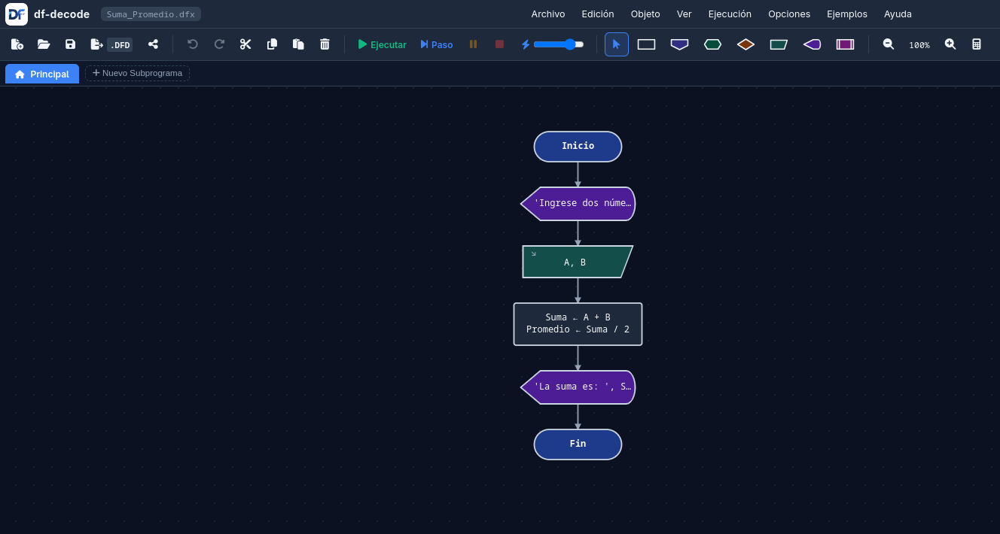

<div align="center">
  

  <h1><i class="fa-solid fa-diagram-project"></i> df-decode <code>v1.0</code></h1>

  <p>
    <strong>Entorno Web (PWA) y de Escritorio para el Diseño, Ejecución Paso a Paso, Depuración y Traducción de Diagramas de Flujo de Datos</strong>
  </p>

  <p>
    <a href="https://github.com/walthercurodelacruz/DF-DECODE/releases"></a>
    <a href="LICENSE"></a>
    <a href="https://github.com/walthercurodelacruz/DF-DECODE"></a>
  </p>

  <p>
    
    
    
    
  </p>

  <br />
  
</div>

---

## <i class="fa-solid fa-circle-info"></i> Descripción General

**df-decode `v1.0`** es una plataforma multiplataforma (Web PWA y Escritorio con Electron) concebida para la enseñanza y el aprendizaje de la lógica algorítmica mediante diagramas de flujo de datos estructurados. Permite construir algoritmos visualmente, ejecutarlos en tiempo real o instrucción por instrucción, inspeccionar la memoria, generar tablas de prueba de escritorio y traducir el diagrama en vivo a lenguajes de programación reales.

---

## <i class="fa-solid fa-scale-balanced"></i> Origen, Autoría y Declaración de Obra Original (No Derivada)

> **Declaración de Obra Independiente:**
>
> **df-decode `v1.0`** es un proyecto de software libre creado y desarrollado íntegramente desde cero por **Walther Curo De La Cruz**.
>
> Este proyecto está **inspirado en la experiencia pedagógica y visual del clásico software educativo DFD**, con el propósito de brindar a docentes y estudiantes una alternativa moderna, multiplataforma y de código abierto. **No es una versión derivada, modificación ni bifurcación (*fork*)** de DFD, Smart DFD ni FreeDFD, y no contiene ni reutiliza código fuente de ninguna de dichas aplicaciones. Toda su arquitectura —incluyendo el analizador léxico, el evaluador descendente recursivo, el motor de layout geométrico en SVG, el intérprete asíncrono basado en generadores y el traductor multi-lenguaje— constituye una implementación original en JavaScript moderno bajo licencia **GNU General Public License v3.0 (GPLv3)**.

---

## <i class="fa-solid fa-layer-group"></i> Características Principales de la Versión `v1.0`

* **<i class="fa-solid fa-bezier-curve"></i> Lienzo Vectorial SVG con Layout Automático:**
  Medición recursiva de sub-árboles y ramas asimétricas (`Sí` / `No`, ciclos anidados) que evita colisiones geométricas, con soporte de *Pan & Zoom*, exportación directa a **SVG** y **PNG** de alta resolución, y 3 temas visuales (**Moderno Oscuro**, **Moderno Claro** y **Clásico Retro**).
* **<i class="fa-solid fa-forward-step"></i> Motor de Ejecución e Intérprete Paso a Paso:**
  Ejecución continua con control de velocidad variable, modo ráfaga para ciclos intensivos, depuración instrucción por instrucción (`F7`), pausa, detención segura en modales de entrada/salida y protección automática contra ciclos infinitos (`500.000` pasos).
* **<i class="fa-solid fa-diagram-project"></i> Subprogramas Recursivos y Arreglos N-Dimensionales:**
  Soporte completo para múltiples hojas de subprogramas, recursividad con pila de llamadas (*Call Stack*) en vivo, paso de parámetros escalares y vectores/matrices (`V(i)`, `M(i, j)`) por valor o referencia.
* **<i class="fa-solid fa-code"></i> Generador de Código en Tiempo Real:**
  Traducción instantánea del diagrama completo (incluyendo inferencia de parámetros por referencia y matrices) a:
  * **Pseudocódigo** (compatible con PSeInt)
  * **Python 3**
  * **JavaScript (ES6)**
  * **C++** (`std::vector`, paso por referencia `&`)
* **<i class="fa-solid fa-table-list"></i> Prueba de Escritorio (*Trace Table*) e Inspector de Memoria:**
  Tabla de variables activas tipadas (`Real`, `Cadena`, `Lógico`, `Arreglo`), evaluador rápido de expresiones (`F4`) y registro histórico paso a paso exportable a **CSV**.
* **<i class="fa-solid fa-file-import"></i> Interoperabilidad de Formatos y Enlaces Compartibles:**
  Formato nativo estructurado **`.dfx`** (JSON), retrocompatibilidad con **`.dfdx`** y lectura/exportación binaria compatible con archivos clásicos **`.dfd`** (codificación Latin-1 / Windows-1252 y UTF-8). Incluye generación de enlaces directos compartibles mediante hash Base64URL (`#dfx=...`) y autoguardado local.
* **<i class="fa-solid fa-wifi"></i> Arquitectura 100% Offline:**
  Iconografía **Font Awesome** y recursos empaquetados localmente dentro de la aplicación, garantizando funcionamiento completo sin conexión a Internet tanto en los instaladores de escritorio (`.deb`, `.rpm`, `.AppImage`, `.exe`) como en la PWA instalable.

---

## <i class="fa-solid fa-microchip"></i> Arquitectura del Proyecto

```text
DF-DECODE/
├── index.html                 # Interfaz principal de la aplicación (v1.0)
├── tests.html                 # Ejecutor visual de pruebas unitarias en navegador
├── manifest.json              # Manifiesto Web App (PWA v1.0)
├── sw.js                      # Service Worker para funcionamiento offline
├── package.json               # Configuración del proyecto, scripts y electron-builder (v1.0.0)
├── LICENSE                    # Licencia GNU General Public License v3.0 (GPLv3)
├── assets/
│   ├── icon.svg               # Icono vectorial de la aplicación
│   ├── icon-512.png           # Icono de escritorio (512x512)
│   ├── icon.ico               # Icono para ejecutables e instalador Windows
│   ├── logo.svg               # Logotipo oficial de df-decode
│   └── fontawesome/           # Iconografía Font Awesome 6.5.2 local para uso offline
├── css/
│   └── styles.css             # Sistema de diseño y temas (Oscuro, Claro y Clásico Retro)
├── electron/
│   ├── main.js                # Proceso principal de Electron, IPC y asociación de archivos
│   └── preload.js             # Puente seguro con Context Isolation y Sandbox
├── js/
│   ├── evaluator.js           # Tokenizador, tabla de símbolos y evaluador recursivo DFD
│   ├── model.js               # Modelo estructural jerárquico del diagrama
│   ├── dfd-format.js          # Serialización e interoperabilidad (.dfx, .dfdx, .dfd)
│   ├── storage.js             # Autoguardado en localStorage y enlaces compartibles (#dfx=)
│   ├── codegen.js             # Traductor AST a Pseudocódigo, Python, JavaScript y C++
│   ├── examples.js            # Galería integrada de algoritmos clásicos
│   ├── renderer.js            # Algoritmo de layout automático y renderizado SVG
│   ├── interpreter.js         # Intérprete asíncrono paso a paso y pila de llamadas
│   └── app.js                 # Controlador de interfaz, eventos, modales e historial Undo/Redo
├── scripts/
│   ├── after-pack.js          # Hook afterPack para incrustar icono y metadatos en df-decode.exe
│   ├── build-rpm.sh           # Constructor nativo de paquetes .rpm con rpmbuild
│   ├── build-win.js           # Constructor multiplataforma del instalador Windows (.exe)
│   ├── postinst               # Script post-instalación Linux (enlaces CLI, MIME y AppArmor)
│   ├── postrm                 # Script post-desinstalación Linux
│   └── installer.nsi          # Script NSIS para instalador de Windows (.exe)
└── tests/
    └── unit-tests.js          # Suite de 35 pruebas unitarias y de integración (Node.js y Web)
```

---

## <i class="fa-solid fa-square-root-variable"></i> Lenguaje de Expresiones, Operadores y Funciones

### <i class="fa-solid fa-cubes"></i> Tipos de Datos
* **Real:** Números enteros, decimales y notación científica (`42`, `3.1416`, `-1.5e3`).
* **Cadena:** Literales de texto delimitados por comillas simples (`'Hola Mundo'`).
* **Lógico:** Valores booleanos `.V.` (Verdadero) y `.F.` (Falso).
* **Arreglos y Matrices:** Vectores 1D y matrices N-dimensionales indexados con paréntesis (`V(i)`, `Matriz(f, c)`).

### <i class="fa-solid fa-arrow-down-1-9"></i> Jerarquía de Operadores
1. **Agrupación:** `( )`
2. **Exponenciación, Unarios y Funciones:** `^` (asociativo por derecha), `+`, `-`, `NOT`, funciones nativas
3. **Multiplicativos:** `*`, `/`, `MOD`
4. **Aditivos y Concatenación:** `+`, `-`
5. **Relacionales:** `<`, `>`, `<=`, `>=`
6. **Igualdad:** `=`, `!=`, `<>`
7. **Lógicos Nivel Conjunción:** `AND`, `NAND`, `NOR`
8. **Lógicos Nivel Disyunción:** `OR`, `XOR`, `XNOR`

### <i class="fa-solid fa-calculator"></i> Funciones Incorporadas
* **Matemáticas:** `SQRT(x)`, `ABS(x)`, `TRUNC(x)`, `ROUND(x)`, `LN(x)`, `LOG(x)`, `EXP(x)`, `RANDOM(x)`
* **Trigonométricas (Grados o Radianes):** `SIN(x)`, `COS(x)`, `TAN(x)`, `ASIN(x)`, `ACOS(x)`, `ATAN(x)`, `SINH(x)`, `COSH(x)`, `TANH(x)`
* **Cadenas:** `LEN(cad)`, `SUBSTRING(cad, inicio, longitud)` (indexación base 1)

---

## <i class="fa-solid fa-keyboard"></i> Atajos de Teclado

| Atajo | Acción |
| :--- | :--- |
| `F9` | Ejecutar diagrama / Reanudar ejecución |
| `F7` | Ejecución Paso a Paso (Depuración) |
| `Ctrl + F2` | Detener ejecución |
| `F4` | Abrir Evaluador de Expresiones |
| `F1` | Abrir Manual de Referencia de Funciones y Operadores |
| `1` .. `7` | Seleccionar herramienta: `1` Asignación, `2` Mientras, `3` Para, `4` Decisión, `5` Lectura, `6` Salida, `7` Llamada |
| `Esc` | Volver al Cursor de selección / Cerrar diálogo modal |
| `Enter` | Editar bloque seleccionado |
| `Supr` / `Backspace` | Eliminar bloque seleccionado |
| `Ctrl + Z` / `Ctrl + Y` | Deshacer / Rehacer |
| `Ctrl + C` / `Ctrl + X` / `Ctrl + V` | Copiar / Cortar / Pegar bloque |
| `Ctrl + M` | Crear nuevo Subprograma |
| `Ctrl + O` / `Ctrl + S` | Abrir archivo / Guardar como `.dfx` |
| `Alt + N` | Nuevo proyecto |

---

## <i class="fa-solid fa-download"></i> Instalación y Uso (`v1.0`)

### <i class="fa-brands fa-linux"></i> Instalación en Linux

#### 1. Distribuciones basadas en RPM (Fedora, RHEL, CentOS, AlmaLinux, Rocky, openSUSE)
```bash
sudo dnf install ./dist/df-decode-1.0.0.x86_64.rpm
```

#### 2. Distribuciones basadas en Debian (Ubuntu, Debian, Linux Mint, Pop!_OS)
```bash
sudo apt install ./dist/df-decode_1.0.0_amd64.deb
```

Una vez instalado en Linux, puedes iniciar la aplicación desde el menú de aplicaciones o desde la terminal con `df-decode` (o el alias corto `decod`), e incluso pasarle directamente un archivo:
```bash
df-decode mi_algoritmo.dfx
```

### <i class="fa-brands fa-windows"></i> Instalación en Windows (Windows 10 / 11 x64)

Ejecuta el instalador asistente NSIS generado en la carpeta `dist/`:
```powershell
.\dist\df-decode-setup-1.0.0.exe
```
El instalador para Windows configura automáticamente:
* Acceso directo en el **Escritorio** y en el **Menú Inicio** (`df-decode`).
* Asociación nativa de archivos **`.dfx`**, **`.dfd`** y **`.dfdx`** para abrir diagramas con doble clic desde el Explorador de Windows.
* Desinstalador integrado en *Configuración de Windows → Aplicaciones instaladas*.

---

## <i class="fa-solid fa-gears"></i> Desarrollo, Pruebas y Compilación desde el Código Fuente

### <i class="fa-solid fa-terminal"></i> Requisitos Previos
* **Node.js** `>= 18.x` y **npm**
* En Linux para empaquetado nativo: `rpmbuild` (paquete `rpm-build` en Fedora o `rpm` en Ubuntu/Debian) y `dpkg`.
* En Windows para empaquetado nativo: `electron-builder` descarga y gestiona automáticamente las herramientas de compilación NSIS.

### <i class="fa-solid fa-code-commit"></i> Comandos del Proyecto

```bash
# 1. Instalar dependencias de desarrollo
npm install

# 2. Ejecutar la suite completa de 35 pruebas unitarias y de integración
npm test

# 3. Iniciar df-decode v1.0 en modo escritorio de desarrollo (Electron)
npm start

# 4. Generar instalador .exe (NSIS x64) para Windows
npm run build:win

# 5. Generar instalador .deb para Debian / Ubuntu
npm run build:linux:deb

# 6. Generar instalador .rpm para Fedora / RHEL / openSUSE
npm run build:linux:rpm

# 7. Generar todos los paquetes para Linux (.deb, .rpm y .AppImage)
npm run build:linux
```

---

## <i class="fa-solid fa-user-check"></i> Autoría y Licencia

* **Autor:** **Walther Curo De La Cruz** (<a href="https://github.com/walthercurodelacruz">@walthercurodelacruz</a>)
* **Versión de Lanzamiento:** `v1.0` (`1.0.0`)
* **Repositorio Oficial:** [https://github.com/walthercurodelacruz/DF-DECODE](https://github.com/walthercurodelacruz/DF-DECODE)
* **Licencia:** Distribuido bajo los términos de la **[GNU General Public License v3.0 (GPL-3.0)](LICENSE)**.

Copyright © 2026 **Walther Curo De La Cruz**. Todos los derechos reservados bajo los términos de la licencia GNU GPL v3.0.
